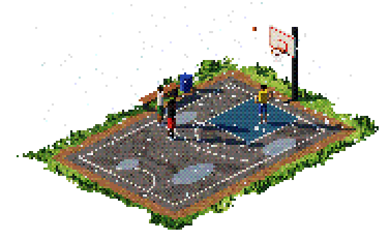

# Pixel Court



A tiny isometric pixel-art basketball court that plays itself, rendered live in the browser with three.js.
Three players run a 3-point shootout in a light drizzle. Shots go in about 45% of the time, the net stretches on a make, teammates clap, and the score ticks up in the corner.

**Part 1 of 3:** **basketball** → 2b-animation → test-game

## Run

```sh
python3 -m http.server 8765
```

Then open http://localhost:8765/index.html. There's no build step. three.js `0.160.0` loads from jsdelivr, so you need internet.

The page is watch-only. There are no controls.

## Code layout

The code is plain ES modules with no bundler. Each module builds its part of the scene when it's imported, so the import order in `main.js` is also the order the scene gets built in.

```
index.html        page shell: styles, the three.js import map, loads src/main.js
src/
  main.js         the frame loop
  stage.js        renderer, scene, isometric camera, lights, the low-res + dither post pass
  util.js         canvas textures, value noise, mesh shorthands
  world.js        grass patch, dirt path, court, hoop, bench and bin
  rain.js         the drizzle, splashes and puddles
  players.js      the three players: bodies, movement styles, gestures, running and walking
  game.js         the shootout rules, the ball and the scoreboard
```

## How it looks the way it does

1. The 3D scene renders into a low-res target, at a quarter of the screen size (`PX = 4`).
2. A post shader applies ACES tone mapping, then a 4×4 Bayer ordered dither, and cuts each channel down to 9 levels.
3. The result is upscaled nearest-neighbour, so every art pixel stays crisp.

The scene is lit by a golden sun with hard `BasicShadowMap` shadows and a cool sky fill.

## What's in it


- A ragged, bumpy grass patch with a dirt path, instanced grass tufts and an asphalt court with puddles.
- A hoop with a wireframe net, plus a bench and a bin.
- Three jointed players built from capsules. They carry momentum, blend between walking and running, and each has a style: glider, bouncy or swagger.
- Gestures: call, point, hands on hips, clap, fist pump, head shake and shrug.
- A rotating shootout. One player shoots, one rebounds, and the next shooter waves for the pass.
- Light drizzle over the patch only, with tiny splashes where the drops land.

## Inspiration

It started with a short clip, `tJ6fU1cwFCPS4lgy.mp4` in this folder. The clip shows an isometric pixel-art basketball court with a few players on it. The goal was to rebuild that look as a live 3D scene instead of hand-drawn sprites. A real 3D scene gets real light, real shadows and real motion, and the dither shader makes it read as pixel art.

## What it led to

This is where the render pipeline was born: low-res render, ACES, Bayer dither, nearest upscale, golden sun and hard shadows. Once that worked and the little jointed players were moving naturally, the obvious next question was how far one character could go up close.
That question became **2b-animation**. It uses the same pipeline and the same sun, with everything spent on a single detailed figure.
